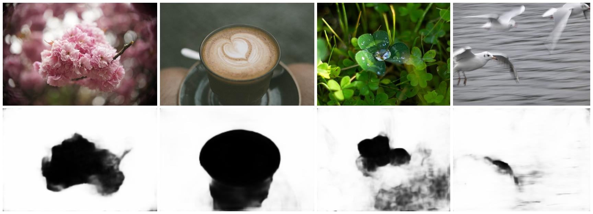

# PixelBlurDetector

**Find the blurry regions of a photo, pixel by pixel, on iOS and Android.**

PixelBlurDetector gives you a blur map with one value per pixel, so you can see which parts of a
photo are in focus and which are blurry. When you only need a yes/no answer, `blurRatio()` reduces
the map to the fraction of blurry pixels. Everything runs on the device with a small
segmentation model, through Core ML on iOS and TensorFlow Lite on Android, and both platforms
produce matching results.

<p>
  
  
  
  
  
  
</p>

<div align="center">
  
  <br />
  <sub><b>Top:</b> input · <b>Bottom:</b> blur map (white = blurry, black = sharp) · CC0 photos, see <a href="#sample-image-credits">credits</a></sub>
</div>

## Features

- **Per-pixel blur map**: separates the sharp subject from defocused or motion-blurred regions,
  rather than returning one score for the whole image.
- **Simple blur check**: `blurRatio()` gives the fraction of blurry pixels, which you can
  threshold to decide whether a photo is blurry.
- **Runs entirely on device**: there is no server or network call. On iOS it uses the CPU, GPU or
  Neural Engine through Core ML; on Android it uses TensorFlow Lite.
- **Same results on iOS and Android**: both platforms run the same float model with the same
  preprocessing code (letterbox and bilinear resample), so a given image produces the same model
  input on each.
- **Any image size**: input is letterboxed to 224×224, and the map is cropped back to the image's
  aspect ratio and EXIF orientation.
- **Built-in profiling**: every result reports how long preprocessing, inference and
  postprocessing took.

## Use cases

- Rejecting blurry shots right after capture, in a camera, document scanner or ID verification flow
- Culling blurry photos in a gallery or photo-backup app
- Finding the subject of a photo with a shallow depth of field, for cropping, refocusing effects or
  portrait-mode checks

## Quick start

### iOS (Swift)

Add the package with Swift Package Manager. In Xcode, choose **File › Add Package Dependencies…**
and enter `https://github.com/syjdev/PixelBlurDetector-iOS`, or add it to your `Package.swift`:

```swift
dependencies: [
    .package(url: "https://github.com/syjdev/PixelBlurDetector-iOS.git", from: "3.0.0"),
],
targets: [
    .target(name: "YourApp", dependencies: [
        .product(name: "PixelBlurDetectorKit", package: "PixelBlurDetector-iOS"),
    ]),
]
```

```swift
import PixelBlurDetectorKit

let detector = PixelBlurDetector()   // an actor; share one instance
try await detector.prepare()         // optional: preload the model

let observation = try await detector.predict(input: cgImage, orientation: .up)

imageView.image = UIImage(cgImage: observation.blurMap)  // brighter = blurrier
let isBlurry = observation.blurRatio() > 0.5
```

See [PixelBlurDetector-iOS](https://github.com/syjdev/PixelBlurDetector-iOS) for the full API.

### Android (Kotlin)

Add the dependency from Maven Central (minSdk 26):

```kotlin
dependencies {
    implementation("io.github.syjdev:pixel-blur-detector:3.0.0")
}
```

```kotlin
import dev.syjdev.pixelblurdetector.PixelBlurDetector
import dev.syjdev.pixelblurdetector.ImageOrientation

val detector = PixelBlurDetector(context)   // share one instance
detector.prepare()                           // optional: preload the model

val observation = detector.predict(bitmap, ImageOrientation.fromExif(exifOrientation))

imageView.setImageBitmap(observation.blurMap)  // brighter = blurrier
val isBlurry = observation.blurRatio() > 0.5f
```

See [PixelBlurDetector-Android](https://github.com/syjdev/PixelBlurDetector-Android) for the full API.

To try the demo apps, see [`examples/`](examples).

## How it works

```
image ──► letterbox to 224×224 ──► segmentation model ──► 224×224 sigmoid map ──► crop back to
(any size,  (aspect fit, black      (Core ML / TFLite)                            aspect ratio,
 EXIF-aware) padding, RGB [0,1])                                                  0–255 grayscale
```

The model was trained with letterbox preprocessing, so both SDKs letterbox the same way. The
bilinear resampler on Android is a line-by-line port of the iOS one; it does not use `Canvas`
filtering. See
[Preprocessing parity with iOS](https://github.com/syjdev/PixelBlurDetector-Android#preprocessing-parity-with-ios)
for details.

## Models

| File | Format | Size | Shipped in |
|---|---|---|---|
| `BlurSegmentation.mlpackage` | Core ML, float | 2.1 MB | [PixelBlurDetector-iOS](https://github.com/syjdev/PixelBlurDetector-iOS) |
| `blur_segmentation_float.tflite` | TFLite, float32 | 4.0 MB | [PixelBlurDetector-Android](https://github.com/syjdev/PixelBlurDetector-Android) |

Input: `1×224×224×3` float32 RGB in `[0, 1]`. Output: `1×224×224×1` float32 sigmoid, where 1 is
blurry.

## Repositories

The SDKs live in their own repositories, so Swift Package Manager and Gradle download only the
SDK:

| Repository | Contents |
|---|---|
| [PixelBlurDetector](https://github.com/syjdev/PixelBlurDetector) (this one) | Overview, demo apps and issues |
| [PixelBlurDetector-iOS](https://github.com/syjdev/PixelBlurDetector-iOS) | iOS SDK (`PixelBlurDetectorKit`), Swift package |
| [PixelBlurDetector-Android](https://github.com/syjdev/PixelBlurDetector-Android) | Android SDK (`io.github.syjdev:pixel-blur-detector`), published to Maven Central |

This repository contains:

```
examples/
├── ios/       iOS demo app — open demo/demo.xcodeproj
└── android/   Android demo app — open in Android Studio
docs/images/   README images and the GitHub social preview
```

## Training data

The model was trained on two research datasets:

- [CUHK Blur Detection Dataset](http://www.cse.cuhk.edu.hk/~leojia/projects/dblurdetect/dataset.html): J. Shi, L. Xu, J. Jia, *Discriminative Blur Detection Features*, CVPR 2014
- [DUT-DBD](https://openaccess.thecvf.com/content_cvpr_2018/html/Zhao_Defocus_Blur_Detection_CVPR_2018_paper.html): W. Zhao, F. Zhao, D. Wang, H. Lu, *Defocus Blur Detection via Multi-stream Bottom-Top-Bottom Fully Convolutional Network*, CVPR 2018

## License

| What | License |
|---|---|
| Source code (SDKs and demo apps) | **Apache-2.0**. Commercial use is allowed; keep [`LICENSE`](LICENSE) and [`NOTICE`](NOTICE) when redistributing. |
| Demo and test images (`cc0_*`) | **CC0** (public domain) from Wikimedia Commons, with no restrictions. See [credits](#sample-image-credits). |
| Models bundled in the SDKs (`.mlpackage`, `.tflite`) | **Unclear; non-commercial for now.** See below. |

The models were trained on the CUHK Blur Detection and DUT-DBD datasets. Neither dataset states a
license, so we can't confirm that commercial use is allowed. Until that's resolved, the models are
offered for research and non-commercial use only. If you want to use them commercially, contact the
dataset authors first. Details are in [`MODEL_LICENSE.md`](MODEL_LICENSE.md).

### Sample image credits

The sample images in the demo apps, the SDK tests and the image at the top of this README
(`cc0_*`) are CC0 photos from Wikimedia Commons, downscaled to 1024 px on the longest side. CC0 needs no attribution; the sources are listed so you
can check where each image came from.

<details>
<summary>Sources (9 images)</summary>

| File | Source (Wikimedia Commons) |
|---|---|
| `cc0_cherry_blossom` | [Brightin Star 35mm f0.95 - Cherry Blossom](https://commons.wikimedia.org/wiki/File:Brightin_Star_35mm_f0.95_-_Cherry_Blossom.jpg) |
| `cc0_flower_bokeh` | [Beautiful Flower covered in an artistic Bokeh](https://commons.wikimedia.org/wiki/File:Beautiful_Flower_covered_in_an_artistic_Bokeh_(54028221085).jpg) |
| `cc0_ant_sunflower` | [Ant on sunflower with snail](https://commons.wikimedia.org/wiki/File:Ant_on_sunflower_with_snail.jpg) |
| `cc0_misty_river` | [Blurry misty river](https://commons.wikimedia.org/wiki/File:Blurry_misty_river.jpg) |
| `cc0_love_in_a_cup` | [Love in a cup (Unsplash)](https://commons.wikimedia.org/wiki/File:Love_in_a_cup_(Unsplash).jpg) |
| `cc0_dew_grass` | [Dew on Grass, beautiful greenery](https://commons.wikimedia.org/wiki/File:Dew_on_Grass,_beautiful_greenery.jpg) |
| `cc0_panning_gulls` (README image only) | [Panning gulls](https://commons.wikimedia.org/wiki/File:Panning_gulls.jpg) |
| `cc0_clover_closeup` | [Trifolium subterraneum close-up](https://commons.wikimedia.org/wiki/File:Trifolium_subterraneum_close-up.jpg) |
| `cc0_icicles` | [Icicles on a winter morning](https://commons.wikimedia.org/wiki/File:Icicles_on_a_winter_morning_(30982282464).jpg) |

</details>

## Contributing

Issues and pull requests are welcome, including bug reports, results on new devices, and
comparisons with other blur-detection methods.
